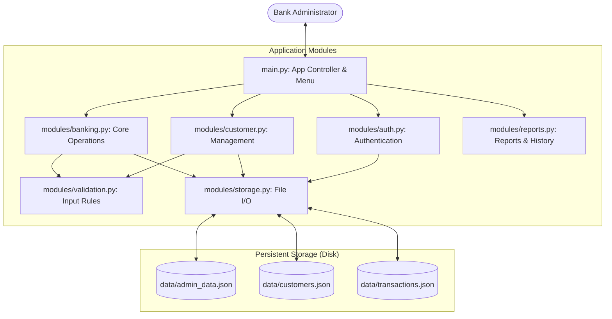
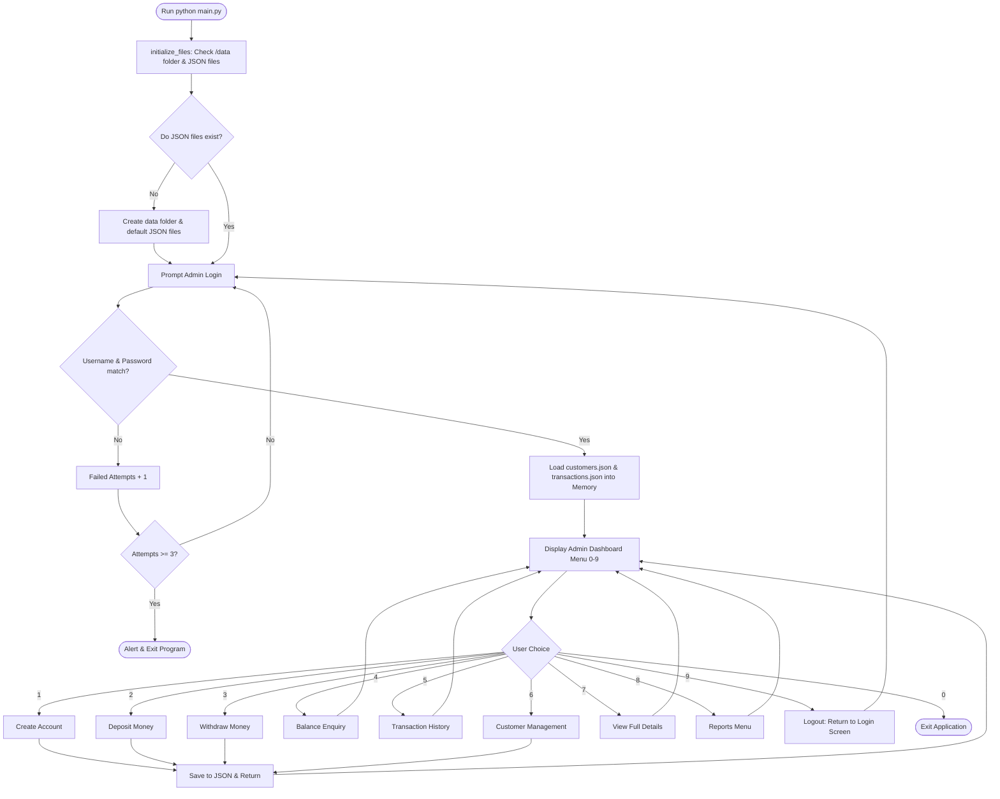
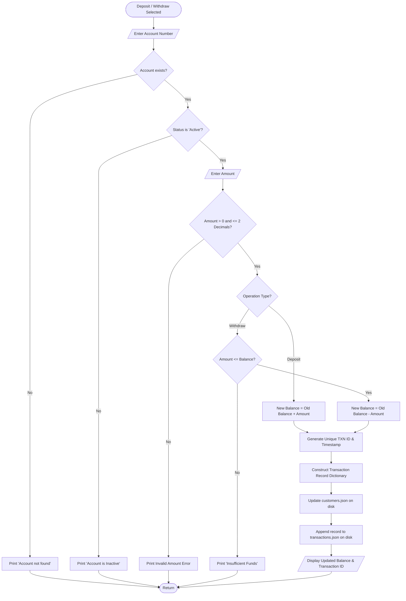
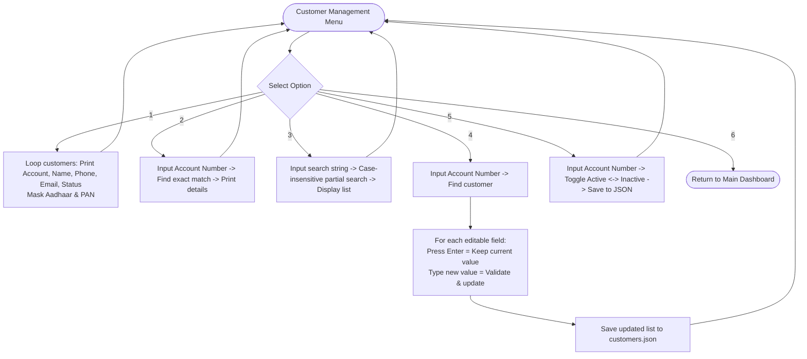

# Banking Management System - Application Flow Diagram

This document explains **behind the scenes** how the entire Banking Management System works, from startup to data persistence. 

All diagrams use standard Mermaid syntax and will render visually inside VS Code or GitHub Markdown preview (`Ctrl + Shift + V` in VS Code).

---

## 1. High-Level System Architecture & Data Flow

Here is how the files talk to each other and how data moves into the JSON storage:



---

## 2. Complete Program Lifecycle Flow

What happens when you type `python main.py` in your terminal:



---

## 3. Account Creation Behind the Scenes (`create_account`)

How each field is prompted, validated, and saved with a unique 10-digit number:

```mermaid
flowchart TD
    StartAcc([Start Account Creation]) --> InName[/Input Name/]
    InName --> VName{Valid Name?}
    VName -- No --> InName

    VName -- Yes --> InDOB[/Input Date of Birth/]
    InDOB --> VDOB{Valid Calendar Date & Not Future?}
    VDOB -- No --> InDOB

    VDOB -- Yes --> InPhone[/Input 10-digit Phone/]
    InPhone --> VPhone{10 Digits & Not Duplicate?}
    VPhone -- No --> InPhone

    VPhone -- Yes --> InAadhaar[/Input 12-digit Aadhaar/]
    InAadhaar --> VAadhaar{12 Digits & Unique?}
    VAadhaar -- No --> InAadhaar

    VAadhaar -- Yes --> InPAN[/Input 10-char PAN/]
    InPAN --> VPAN{5 letters + 4 digits + 1 letter & Unique?}
    VPAN -- No --> InPAN

    VPAN -- Yes --> InAddr[/Input Address/]
    InAddr --> VAddr{Not Empty?}
    VAddr -- No --> InAddr

    VAddr -- Yes --> InEmail[/Input Email/]
    InEmail --> VEmail{Valid @ and domain & Unique?}
    VEmail -- No --> InEmail

    VEmail -- Yes --> InMother[/Input Mother's Name/]
    InMother --> VMother{Not Empty?}
    VMother -- No --> InMother

    VMother -- Yes --> GenAcc[Generate Random 10-Digit Account Number]
    GenAcc --> CheckAccDup{Account number already used?}
    CheckAccDup -- Yes --> GenAcc
    CheckAccDup -- No --> BuildCustDict[Construct Customer Dictionary:\nbalance = 0.0, status = 'Active', timestamp]

    BuildCustDict --> SaveCust[Append to customers list & write to data/customers.json]
    SaveCust --> PrintReceipt[/Print Account Creation Receipt/] --> EndAcc([Return to Dashboard])
```



---

## 4. Deposit & Withdrawal Flow

How money operations validate accounts, check funds, update balance, and record audit trails:



---

## 5. Customer Management Submenu Flow



---

## 6. Reports & Aggregation Flow

```mermaid
flowchart TD
    ReportsStart([Reports Menu]) --> RepChoice{Select Report}

    RepChoice -- 1 --> RepCustList[Display All Customers Table] --> ReportsStart
    RepChoice -- 2 --> RepTxnList[Display All Transactions Table] --> ReportsStart
    RepChoice -- 3 --> CountCust[Calculate len(customers) -> Display total] --> ReportsStart
    RepChoice -- 4 --> CountActive[Count customers where status == 'Active'] --> ReportsStart
    RepChoice -- 5 --> CountInactive[Count customers where status == 'Inactive'] --> ReportsStart
    RepChoice -- 6 --> SumDeposits[Sum transaction amounts where type == 'Deposit'] --> ReportsStart
    RepChoice -- 7 --> SumWithdraws[Sum transaction amounts where type == 'Withdrawal'] --> ReportsStart
    RepChoice -- 8 --> BackMain([Return to Main Dashboard])
```
